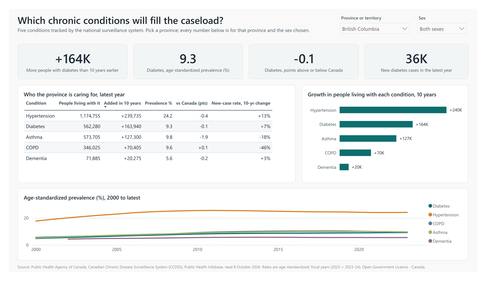
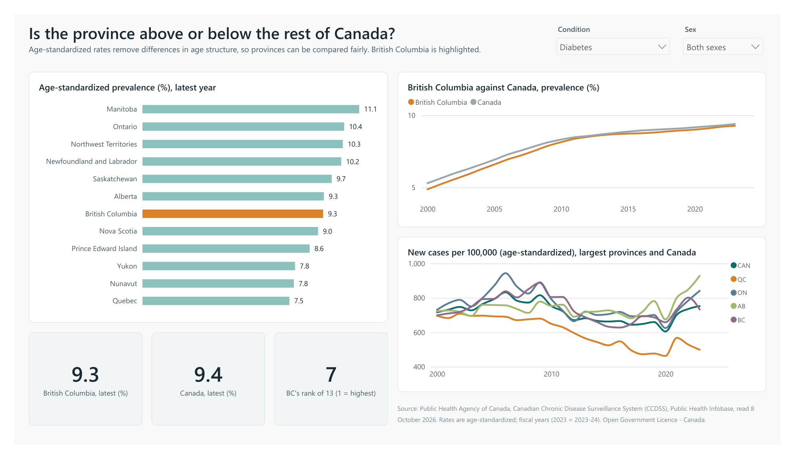
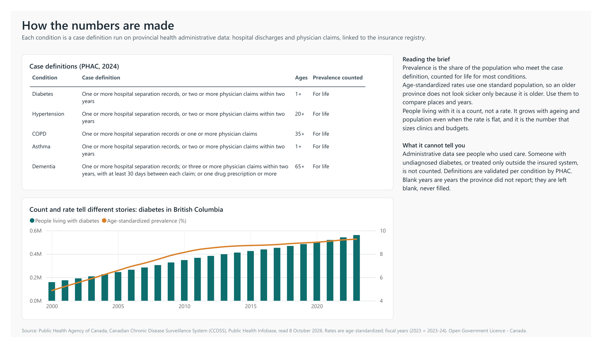

# Chronic Disease Brief

**TL;DR.** A Power BI report on five chronic conditions in Canada, built from the Public Health Agency of Canada's open
surveillance data, with a one-page brief for a manager who is not an analyst. The question it answers: *which chronic
conditions will fill a province's caseload, and is the province above or below the rest of Canada?* For British
Columbia the answer is hypertension and diabetes: about 240,000 and 164,000 more people living with them than ten years
earlier, while their age-standardized rates are flat or falling. **[Read the brief](BRIEF.md)** ·
**[PDF of the report](exports/Chronic%20Disease%20Brief.pdf)**



## What is in it

| | |
|---|---|
| `BRIEF.md` | the one-page answer, with what to check before acting |
| `exports/` | the report exported from Power BI Desktop as PDF, and one image per page |
| `report/` | the report as a Power BI project (PBIP): semantic model in TMDL, pages and visuals in PBIR |
| `scripts/fetch_ccdss.py` | downloads the series from the PHAC data tool (robots.txt checked; 3 s between requests) |
| `scripts/prepare_data.py` | turns the download into `data/rates.csv`, `geography.csv`, `condition.csv`, with checks |
| `scripts/build_pbip.py` | writes the whole Power BI project: tables, relationships, 19 DAX measures, 3 pages |

## The report

1. **Caseload.** Pick a province and sex. Four headline cards, a table of the five conditions (people living with each,
   growth in ten years, age-standardized prevalence, gap to Canada, change in the new-case rate), and the trend since
   2000.
2. **Provinces compared.** Pick a condition. Age-standardized prevalence for all 13 provinces and territories with BC
   highlighted, BC against Canada over time, new-case rates in the largest provinces, and BC's rank.
3. **How the numbers are made.** The PHAC case definition for each condition, and a chart showing why a count and a
   rate tell different stories.




## The model

A star schema: one fact table (`Rates`: condition, geography, measure, year, sex, rate, confidence interval, case
count, flag) and two dimensions (`Geography`, `Condition`). Measures follow one rule: **rates are compared, counts are
sized.** Rate measures fix sex to the slicer's choice or *Both sexes*; "latest year" is computed per condition and
geography; the gap to Canada is blank when either side is missing, never zero. Examples:

```
Prevalence, latest = VAR y = [Latest year] RETURN CALCULATE([Prevalence (ASR %)], Rates[Year] = y)
Gap to Canada (pts) = VAR a = [Prevalence, latest] VAR c = [Prevalence, Canada latest]
                      RETURN IF(NOT ISBLANK(a) && NOT ISBLANK(c), a - c)
Province rank       = RANKX(FILTER(ALL(Geography), Geography[Level] = "Province/territory"), [Prevalence, latest], ...)
```

## Checks

* **The download is checked against what was asked.** The data tool echoes the selection it served; every row carries
  it, and `prepare_data.py` refuses the file if any row came back for a different selection. 140 of 140 series arrived.
* **The report's numbers were recomputed outside Power BI.** The BC table on page 1 was reproduced from `rates.csv` in
  Python; every value matched.
* **Missing years stay missing.** 1,455 of 9,912 rows have no rate (PHAC flags them); they are blank in the report.

## Limits

* Two conditions requested, mood and anxiety care use and multimorbidity, returned a server error from the data tool
  and are not included.
* Administrative data count people who used insured care; undiagnosed disease is not counted.
* People counts overlap across conditions.
* The report is published as files, not a live Power BI link: *Publish to web* needs an organisational Power BI
  account.

## Run it

```
python scripts/fetch_ccdss.py data/raw/ccdss-datatool.jsonl 1,2,7,6,16 00,10,11,12,13,24,35,46,47,48,59,60,61,62 1,2
python scripts/prepare_data.py data/raw/ccdss-datatool.jsonl data
python scripts/build_pbip.py . "C:\path\to\chronic-disease-brief\data"
```

Then open `report/Chronic Disease Brief.pbip` in Power BI Desktop and press **Refresh**. A clone can skip the first two
steps (the CSVs are in `data/`) and only set the data folder: rerun `build_pbip.py` with its own path, or change the
`DataFolder` parameter under *Transform data > Manage parameters*.

## Source and licence

Public Health Agency of Canada, Canadian Chronic Disease Surveillance System, Public Health Infobase data tool, read
8 October 2026; case definitions from PHAC's 2024 workbook. Contains information licensed under the
[Open Government Licence - Canada](https://open.canada.ca/en/open-government-licence-canada).
